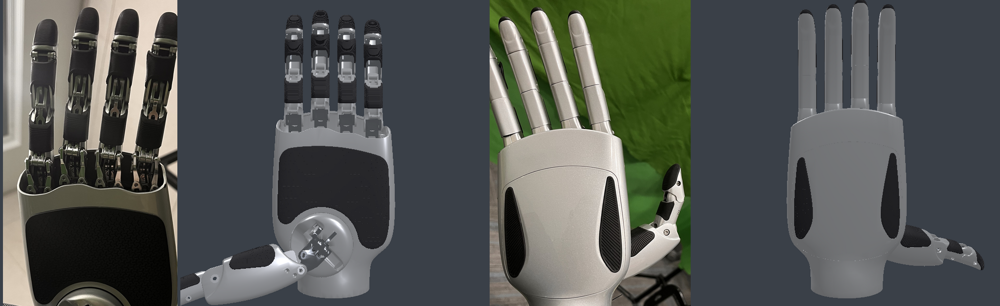
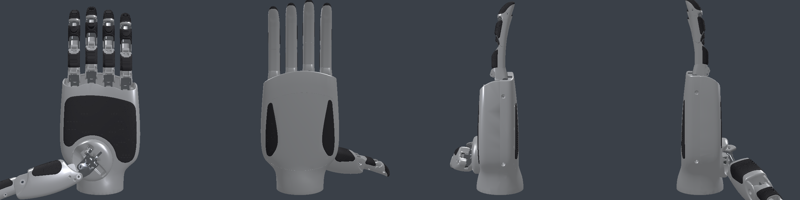
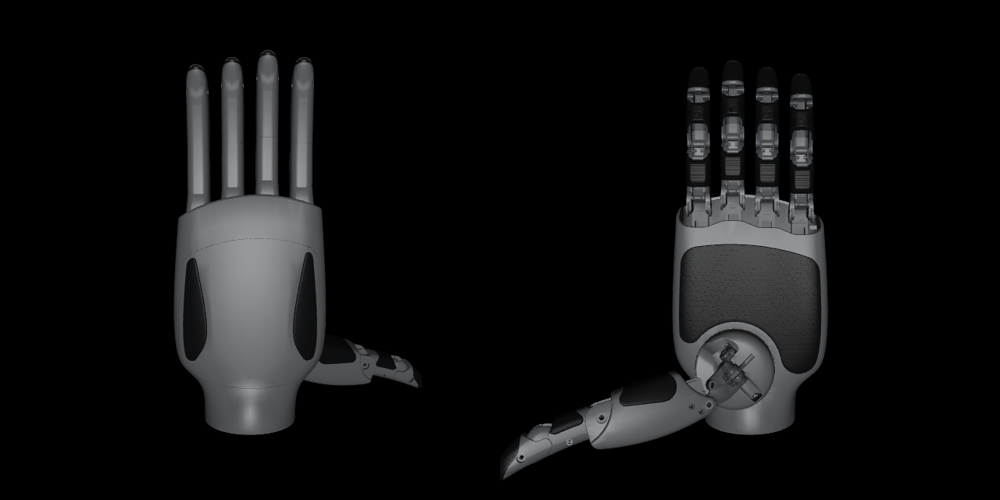

# g20_pbr_description

LinkerHand G20 left and right hand descriptions with per-material visuals: painted shell, rubber pads, stainless linkage, internal steel and the aluminium wrist disc. URDF (glTF and OBJ visuals), MuJoCo MJCF and a ROS 2 package layout are generated from the official LinkerHand files.

**Unofficial.** Not affiliated with or endorsed by LinkerHand. Kinematics, inertial properties and collision meshes are LinkerHand's, unchanged; only the visual meshes and materials differ.



## Download

Use the zip from the [latest release](https://github.com/5o1/g20_pbr_description/releases/latest). It contains the built package, ready to load; this repository holds the sources that build it.

```text
g20_pbr_description/
  urdf/g20_{left,right}.urdf          visuals: GLB with embedded PBR materials
  urdf/g20_{left,right}_basic.urdf    visuals: OBJ + URDF RGBA materials
  urdf/ros/*.urdf                     the same, with package:// mesh paths
  mjcf/g20_{left,right}.xml           MuJoCo
  meshes/visual/{left,right}/         *.glb, *.obj, *.mtl (smoothed normals)
  meshes/collision/{left,right}/      LinkerHand STL, unmodified
  materials.json  build_manifest.json  LICENSE  NOTICE  package.xml  CMakeLists.txt
```

Link and joint names match the LinkerHand URDF, so the files can replace it directly in existing retargeting or control code. Robot names are `g20_pbr_left` and `g20_pbr_right`.

## Which file to load

| Tool | File | Notes |
|---|---|---|
| SAPIEN 3 | `urdf/g20_<side>.urdf` | Validated. Materials load from the GLB files. |
| Isaac Sim / Isaac Lab, Blender, glTF viewers | `urdf/g20_<side>.urdf` | Not validated here; glTF PBR is the standard path. |
| MuJoCo | `mjcf/g20_<side>.xml` | Validated. MuJoCo has no PBR, so colours are RGBA only. |
| PyBullet, yourdfpy, other URDF parsers | `urdf/g20_<side>_basic.urdf` | Validated. |
| ROS 2 (rviz, robot_state_publisher) | `urdf/ros/g20_<side>_basic.urdf` | Install as an ament package; not validated in rviz. |

```python
# SAPIEN 3
loader = scene.create_urdf_loader()
loader.fix_root_link = True
hand = loader.load("g20_pbr_description/urdf/g20_left.urdf")

# MuJoCo
model = mujoco.MjModel.from_xml_path("g20_pbr_description/mjcf/g20_left.xml")
```

In the MJCF, visual geoms are group 1 and never collide; collision geoms are group 3. URDF mimic joints (thumb IP, finger DIP) become `<equality><joint>` constraints. No actuators are included.

## Materials

| Material | sRGB | Metallic / roughness | Parts |
|---|---|---|---|
| `shell_silver` | `#b0b2b6` | 0.50 / 0.35 | Palm and dorsal housing, dorsal cover, finger dorsal covers, thumb shells, thumb-root cover |
| `rubber_black` | `#1e1f21` | 0.00 / 0.82 | Palm pad, finger and thumb pads, dorsal teardrop inserts |
| `steel_link` | `#80848a` | 1.00 / 0.22 | Finger mount lugs, metacarpal brackets, middle frames, distal link plates, thumb pins and bearings |
| `steel_dark` | `#4a4d50` | 0.85 / 0.42 | Plates inside the thumb root |
| `wrist_aluminium` | `#cccfd2` | 1.00 / 0.25 | Wrist mounting disc |

Colours are estimates from photographs of a G20 left hand under indoor light, not measured reflectance. glTF stores base colours as linear RGB; the URDF and MJCF RGBA values are the sRGB colours above.

## How the visuals are made

Every LinkerHand STL already consists of separate solid bodies (pads, shell halves, linkage plates, lugs). `config/parts.json` assigns each body to a material by its surface area and bounding-box extents. The table was made by rendering every left-hand body with a numbered colour and matching it against photographs. The right-hand meshes are re-triangulated mirrors with the same body signatures. A body that matches no rule stops the build instead of receiving a guessed material. Geometry is never moved or simplified: the parts of each link reproduce the source surface exactly. Vertex normals are smoothed within 30° so curved shells render without facets, while sharper edges stay crisp.

Known limits:

- The material resolution is one solid body. Where a single body has two finishes on the real hand, such as the dark inner wall of the palm opening, the body uses its outer finish.
- Without an environment map, metals look darker and flatter than in photographs.

## Source

LinkerHand G20 uses the L25 geometry from [linker-bot/linkerhand-urdf](https://github.com/linker-bot/linkerhand-urdf), commit `49f2602` (`L25/left`, `L25/right`). The URDF and meshes shipped with LinkerHand G20 hardware match these byte for byte, apart from the robot name. Every upstream file is pinned by SHA256 in `config/upstream.json` and verified before building.

## Build and validate

Python 3.10+.

```sh
git clone https://github.com/linker-bot/linkerhand-urdf /path/to/linkerhand-urdf
git -C /path/to/linkerhand-urdf checkout 49f26021b0a91ff5c33150df22970c07bb548672
python -m pip install -r requirements.txt
python scripts/build.py --upstream /path/to/linkerhand-urdf
MUJOCO_GL=osmesa python scripts/validate.py --package build/g20_pbr_description \
  --upstream /path/to/linkerhand-urdf --media build/media
python -m pytest tests
```

`validate.py` checks each hand:

- Joints, inertials and collision geometry in all four URDFs equal upstream.
- The visual parts reproduce every upstream surface.
- Forward kinematics of every link equals upstream at random joint values (yourdfpy).
- PyBullet loads the basic URDF.
- MuJoCo body positions equal the URDF at the same joint values.
- SAPIEN loads the five materials from the GLB files.

The last results are in [docs/media/validation.json](docs/media/validation.json).




MuJoCo rejects one upstream inertia tensor (`thumb_metacarpals_base2`, which fails A + B ≥ C), so the MJCF uses MuJoCo's `balanceinertia` for it. The URDFs keep the upstream values.

## License

[Apache-2.0](LICENSE). The upstream geometry, kinematics and inertials are Copyright 2025 LinkerHand, Ltd., Apache-2.0. The modifications (material split, normals, materials, MJCF and build tools) are Copyright 2026 5o1. See [NOTICE](NOTICE) for the list of changes.
